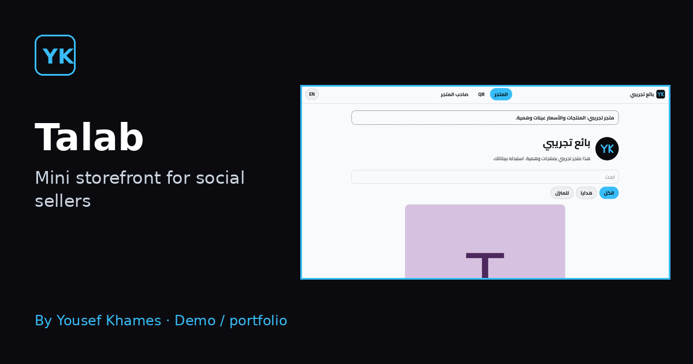

<div align="center">


# talab

**talab** · demo / portfolio project

**متجر مصغّر للبائعين على السوشيال** · مشروع تجريبي للعرض

[Live demo](https://yousefkhames.github.io/talab/) · By Yousef Khames · من تطوير يوسف خميس



</div>

---

# talab · طلب

A white-label mini storefront for sellers who sell through Instagram and Facebook: a profile header with social links, a single-column product feed, a page and share link for every product, QR code, and order drafts through WhatsApp or Messenger. Arabic RTL and English LTR. Static HTML, CSS and JavaScript; no build, account, API or payment processor.

<div lang="ar" dir="rtl">متجر مصغر لبائعي إنستغرام وفيسبوك. صفحة تعريف، منتجات، رابط لكل منتج، وطلب عبر واتساب أو ماسنجر. لا يوجد دفع داخل الأداة.</div>

 **By Yousef Khames · من تطوير يوسف خميس**

## Preview locally

```sh
python3 -m http.server 8080 --bind 127.0.0.1
```

Open `http://localhost:8080/`. Use a fresh browser profile. The sample shop is **demo content**: fictional products and prices, a Demo banner, a Demo tag on every product and labelled placeholder images. No WhatsApp number is set, so the order screen offers **Copy order** only. Screenshots in `docs/` use this demo data.

## Set up a shop

1. Open **Owner** (`#/edit`). Set the shop name, about text, currency, the public WhatsApp number and your Instagram, Facebook, TikTok and Messenger handles. Only public business handles belong here.
2. Press **Clear demo products**, then add your products with a photo, price and short description.
3. Press **Export catalog-data.js**, replace `catalog-data.js` in the repository with the downloaded file, commit and publish. Owner edits are a local draft; visitors see the published file only.
4. Each product has its own link (`#/p/<id>`) and a Share button. Put the shop link in your bio and use the **QR** tab to print a code.
5. Orders: with a WhatsApp number the customer gets a WhatsApp draft. With a Messenger username the customer gets a button that opens your Messenger chat and copies the order; Messenger cannot take prefilled text, so they paste and send it themselves.

Static theming: edit `assets/kit-theme.js` (`name`, `logo`, `accent`, `mode`, `light`, `dark`). Keep `assets/yk-logo.svg` and `assets/favicon.svg` for the developer credit. The shared storefront engine (`shop-core.js`, `shop-ui.js`) is the same across the talab, mahal and lebs kits.

## Deploy (GitHub Pages)

Create the repository `yousefkhames/talab`, commit these files to `main`, then Settings → Pages → Deploy from a branch → `main` / root. Live at `https://yousefkhames.github.io/talab/`. All paths are relative.

## Tests

```sh
npm run test:unit  # Node 22+, no install
npm run test:e2e   # headless Chrome as google-chrome
npm test
```

## Honest limits and privacy

- Opening a WhatsApp draft is not sending. The customer presses send, and the order is not confirmed until the shop replies. The app records no orders.
- Totals use the shop prices in the catalog. There is no shipping, tax, discount code or payment; the shop confirms the final price.
- Messenger orders need a paste step. Instagram has no prefilled-message link, so the Instagram link only opens your profile.
- Product photos are resized in the browser and embedded in the exported file; many photos make `catalog-data.js` large. Relative image paths such as `img/photo.jpg` also work if you commit the image.
- Static and device-local: the owner draft does not sync between devices. Clearing site data erases it, so export first.
- No customer data is collected or stored; the optional name and note go only into the WhatsApp message the customer sends.
- Contrast of the default theme pairs is checked; no blanket WCAG claim.

## License

MIT, copyright Yousef Khames. See `LICENSE`. Cairo font: SIL OFL. `assets/qrcode.js`: qrcode-generator by Kazuhiko Arase (MIT, `assets/qrcode.LICENSE.txt`).
