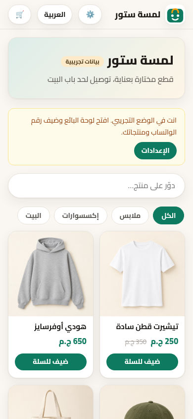
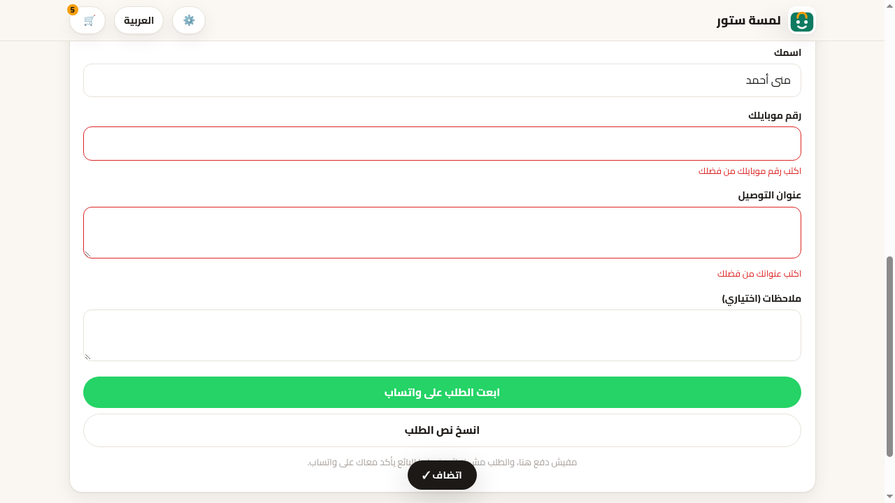
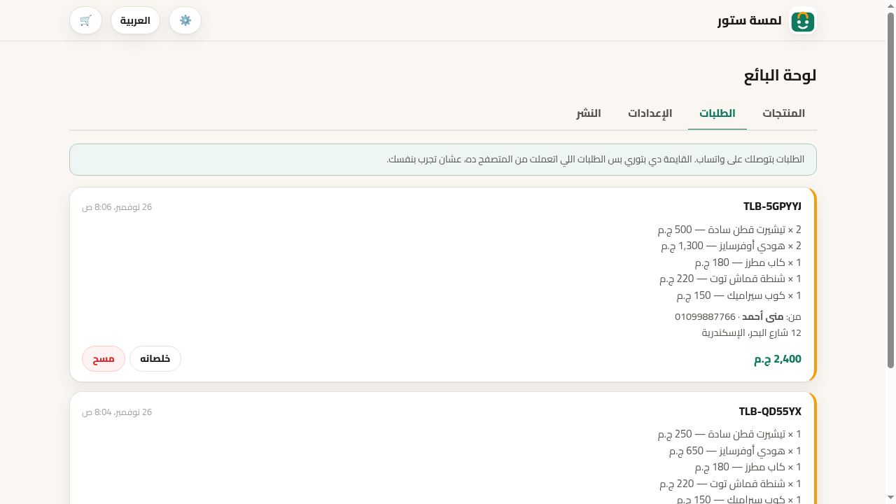
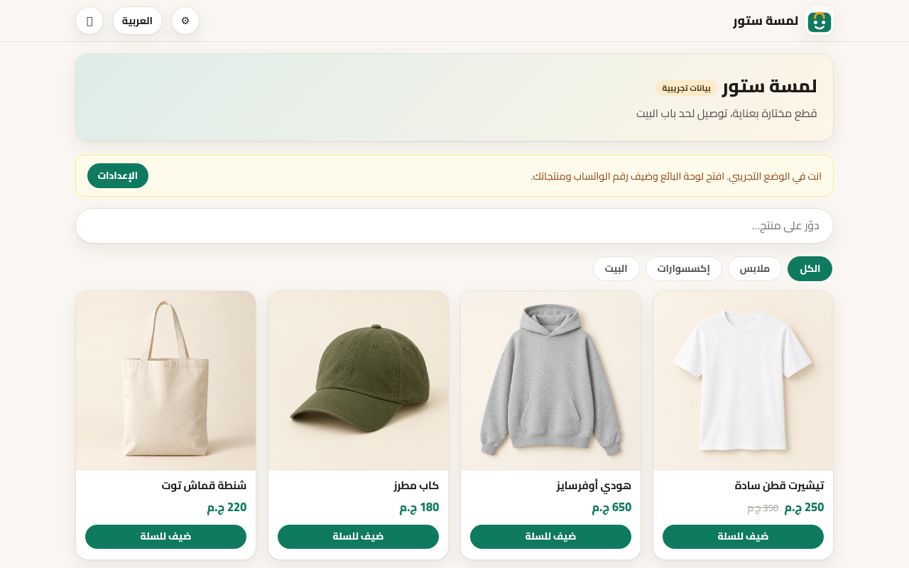

# Talab | طلب

**A mini storefront for Instagram and Facebook sellers. Share one link; orders land in your WhatsApp.** Free, no server, no sign-up. Arabic and English.

**Live demo:** https://yousefkhames.github.io/talab/

| Storefront (Arabic) | Cart & checkout | Seller dashboard |
|---|---|---|
|  |  |  |

Demo product photos are AI-generated samples, not real products.

## Screenshots

Captured from the live site (https://yousefkhames.github.io/talab/).

<p>
  
  
</p>

## Why
Thousands of small sellers run their whole business in Instagram DMs: "price?", "available?", "send your address." Talab gives a seller a tiny shop they can set up in minutes on their phone. Customers browse a clean catalog, fill a short form, and tap one button — the full order opens in the seller's WhatsApp, ready to send. No account, no commission, no payment gateway.

## Features
- Storefront: product grid, search, category chips, product pages, sold-out state, old-price strikethrough
- Cart with quantity steppers, delivery fee, live totals
- Checkout form (name, phone, address, notes — fields toggleable) with validation
- Order is composed into a neat WhatsApp message and opened via `wa.me`; copy-to-clipboard fallback
- Seller dashboard on the same link: product CRUD with photos, stock toggle, order list, settings, share
- White-label settings: shop name, tagline, logo, WhatsApp number, country code, currency code and symbol, colors, default language, delivery fee, checkout fields, Instagram/Facebook links
- One-file export/import (JSON) of the whole shop: backup, move devices, or hand a ready-made setup to another shop
- Product photos resized on-device (max ~900 px) and stored locally
- Arabic RTL and English LTR, instant toggle, Egyptian-arabic UI copy
- Egyptian phone numbers like `01012345678` are converted to international format automatically
- Installable PWA, works offline after first load (service worker)
- Accessible basics: labels, focus rings, skip link, reduced motion
- Unit and smoke tests (`npm test`)

## Privacy
No server, no account, no analytics. Everything lives in the browser's localStorage. An order only leaves the device when the customer taps send in WhatsApp.

## Tech stack
Plain HTML, CSS and JavaScript (ES modules). No framework and no build step. localStorage for data, canvas for photo resizing, `wa.me` deep links for orders, a service worker for offline.

## Run it
```
git clone https://github.com/yousefkhames/talab
cd talab/docs
python3 -m http.server 8000
```
Open http://localhost:8000. The site is served from `docs/` by GitHub Pages.

## Tests
```
npm test
```
Node unit tests cover money formatting, Egyptian phone normalization, cart math, order snapshot, WhatsApp message building, export/import validation, and Arabic/English dictionary parity; smoke tests check that every file the app references exists.

## Honest limits
- Orders are not confirmed until the seller replies on WhatsApp. Talab sends no data anywhere by itself.
- Data stays in one browser on one device. Clearing site data deletes the shop. Use the export file as a backup.
- The seller dashboard has no password. Anyone who opens the link can edit the shop in their own browser — edits do not affect other visitors, because there is no shared server. A real multi-user shop needs a backend.
- Order history in the dashboard shows only orders placed in that same browser.
- No payments, no shipping integration, no inventory sync.
- The Cairo font is bundled in `docs/fonts/`, so the shop makes no third-party requests.

## License
MIT, see [LICENSE](LICENSE).

## Round 2 review notes
- Importing a shop file now asks before replacing the current shop; a full or blocked browser storage shows a message instead of failing silently.
- Already solid in review: settings sanitiser, local 01x numbers get the country code, copy fallback, empty states.
- Limit: WhatsApp links are only verified as generated wa.me URLs.
